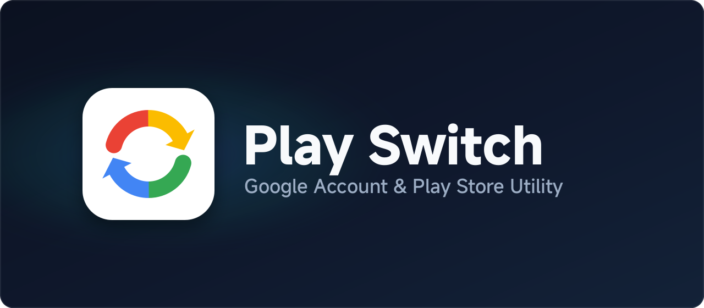
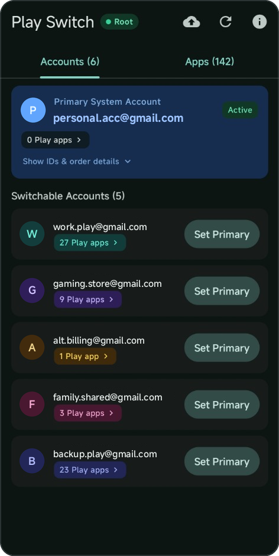
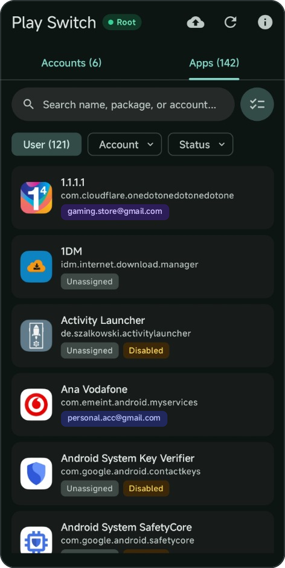
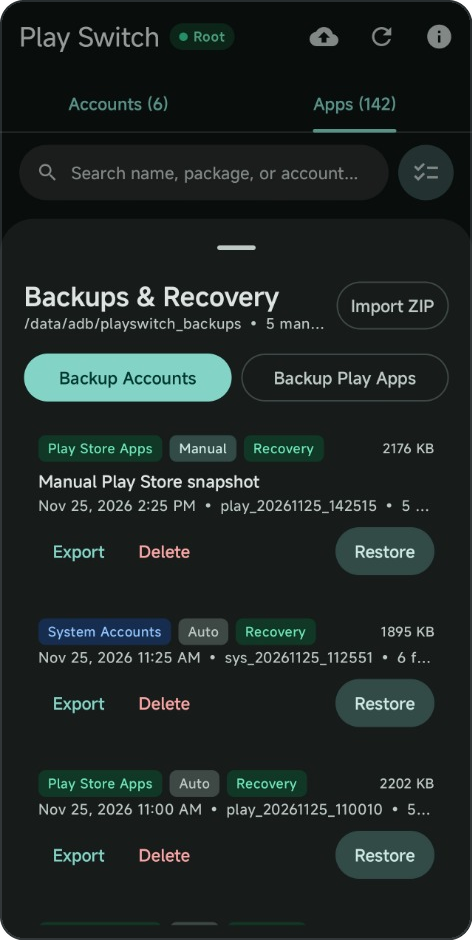
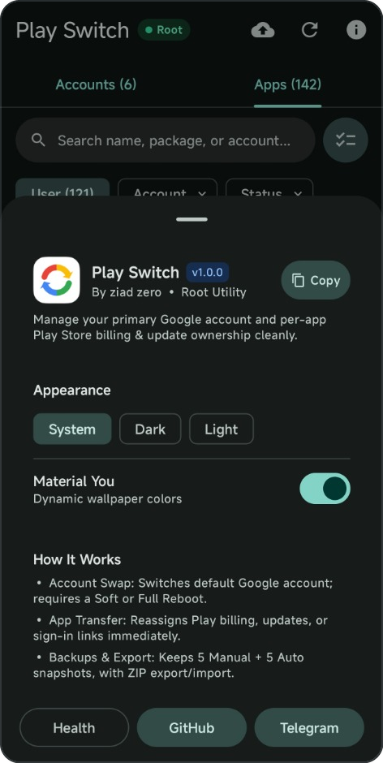
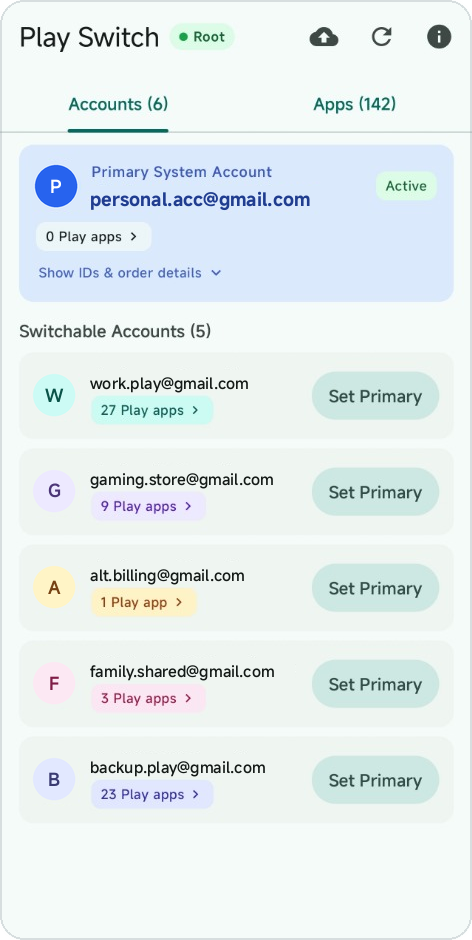
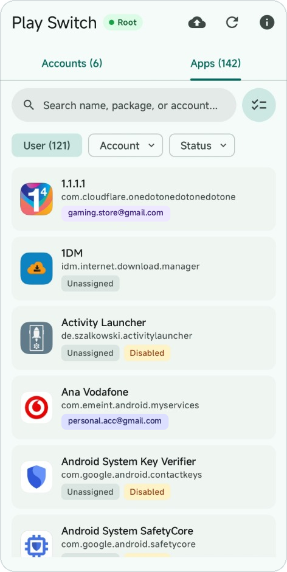
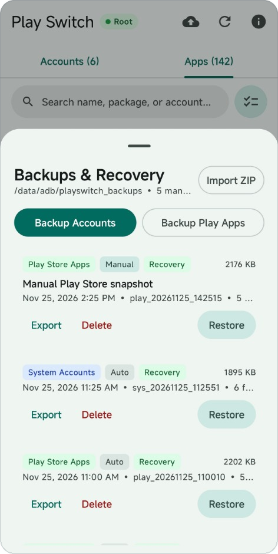
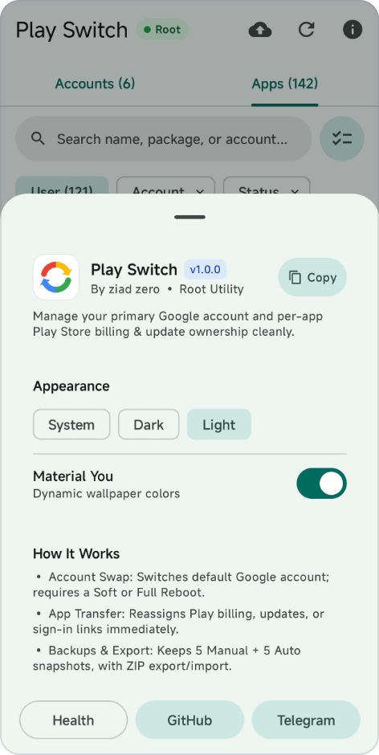

<p align="center">
  
</p>

<p align="center">
  Switch your phone's main Google account and change which Google account each Play Store app uses.
</p>

<p align="center">
  
  
  <a href="LICENSE"></a>
  <a href="https://github.com/Ziadzero0/PlaySwitch/releases"></a>
</p>

---

## What It Does

- **Main Google Account:** Choose which Google account is primary on your phone without signing out of your other accounts *(requires a restart)*.
- **Per-App Play Account:** Change which Google account an app uses in Google Play — **Purchases**, **Updates**, or **Both** — immediately without restarting.
- **Clear Stuck Sign-In:** Reset an app's saved Google sign-in link if it keeps picking an old account.
- **Automatic Backups:** Checks Google system & Play Store files before making edits, rolls back automatically if a swap fails, and saves backups (with ZIP export/import).
- **100% Offline:** Works locally with root only — no servers, tracking, or account data ever leaves your device.

---

## Screenshots

<table>
  <tr>
    <td align="center" width="50%">
      <strong>Accounts</strong><br>
      
    </td>
    <td align="center" width="50%">
      <strong>Apps</strong><br>
      
    </td>
  </tr>
  <tr>
    <td align="center" width="50%">
      <strong>Backups</strong><br>
      
    </td>
    <td align="center" width="50%">
      <strong>About</strong><br>
      
    </td>
  </tr>
</table>

<details>
<summary>Light Mode</summary>

<table>
  <tr>
    <td align="center" width="50%">
      <strong>Accounts</strong><br>
      
    </td>
    <td align="center" width="50%">
      <strong>Apps</strong><br>
      
    </td>
  </tr>
  <tr>
    <td align="center" width="50%">
      <strong>Backups</strong><br>
      
    </td>
    <td align="center" width="50%">
      <strong>About</strong><br>
      
    </td>
  </tr>
</table>

</details>

---

## Download

[](https://github.com/Ziadzero0/PlaySwitch/releases/latest)

Get the latest APK from [Releases](https://github.com/Ziadzero0/PlaySwitch/releases/latest).

## Requirements

- Rooted Android **10+** via **Magisk**, **KernelSU**, or **APatch**
- Google Play Store (`com.android.vending`)

---

<details>
<summary>Technical Notes & Building</summary>

- **Main account swap:** Updates `accounts_ce.db`, `accounts_de.db`, and `finsky.xml` (if present).
- **Play Store account change:** Updates `localappstate.db` (`appstate.account` / `account_for_update`) and `library.db` (`ownership.account`).
- **Sign-in reset:** Removes `perm.<pkg>:%` and `EXP:<pkg>:%` rows from `accounts_ce.db` (`authtokens`).
- **Backups folder:** `/data/adb/playswitch_backups/` (up to 5 manual + 5 auto snapshots per category, each with `restore.sh`).
- **Channel model:** User `Beta` & `Stable` releases share one package ID (`com.playswitch.ziadzero`) and the same release signature; developer `debug` builds use `.debug`.
- **Architecture doc:** [`docs/ARCHITECTURE_BLUEPRINT.md`](docs/ARCHITECTURE_BLUEPRINT.md)

```bash
./gradlew testDebugUnitTest
./gradlew assembleDebug assembleRelease
```

</details>

## License

[GNU GPL v3.0](LICENSE)
